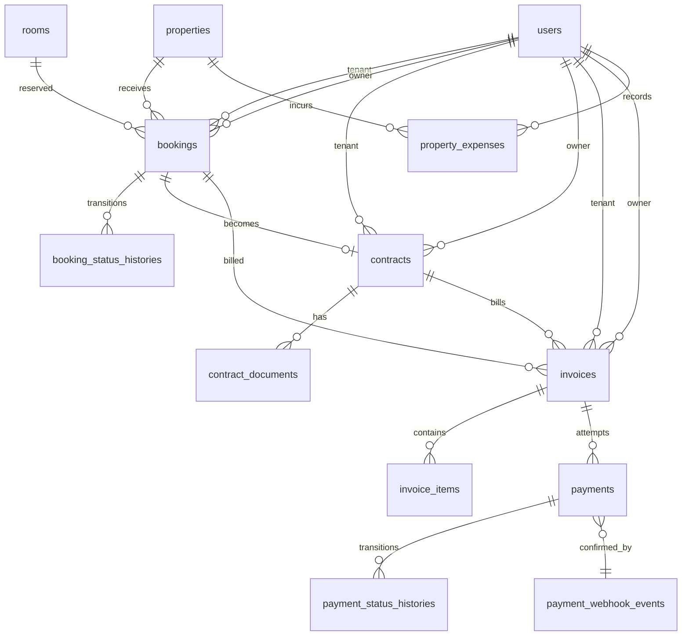
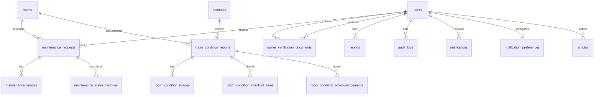

# Nestari — Database Architecture and ERD

PostgreSQL is the source of truth. Prisma Migrate is the only schema-change tool
for application tables. Supabase Auth/Storage, if enabled, manage only their own
schemas and buckets.

## 1. Conventions

- UUID primary keys (`gen_random_uuid()` via Prisma `uuid()`).
- `snake_case` tables/columns; plural table names; enums mapped to snake_case.
- `TIMESTAMPTZ(6)` for instants, `DATE` for rental/billing periods.
- Money `NUMERIC(14,2)`; rates/quantities `NUMERIC(10,2)`; coordinates
  `NUMERIC(10,7)`.
- Foreign keys are mandatory unless the relationship is genuinely optional.
- Transactional history is `RESTRICT` on delete; dependent child media is
  `CASCADE`; optional references are `SET NULL`.
- Soft delete only for `users`, `properties`, `rooms`; financial history is never
  deleted.
- All list endpoints paginate; FK columns used in list/filter queries are indexed.

## 2. Modules and tables (46)

### Identity & access
1. `users` — profile, role, account status, auth metadata.
2. `owner_profiles` — owner business identity and verification state.
3. `tenant_profiles` — tenant occupation/emergency contact.
4. `sessions` — hashed opaque session tokens, expiry/revocation.
5. `password_reset_tokens` — one-time hashed tokens.
6. `email_verification_tokens` — one-time hashed tokens.

### Supply
7. `properties` — core listing; verification vs publication separation.
8. `property_images` — ordered gallery.
9. `rooms` — unit inventory, price, status, last availability confirmation.
10. `room_images`.
11. `facilities` — master data.
12. `property_facilities`.
13. `room_facilities`.
14. `property_rules`.
15. `cost_components` — rent, deposit, utilities; fixed/variable/one-time/monthly.
16. `nearby_places` — cached/seed nearby POIs.
17. `destinations` — campus/office/station reference points for KosMatch/routes.
18. `property_views` — lightweight analytics.

### Demand & discovery
19. `favorites` — unique user/property.
20. `user_preferences` — KosMatch defaults.
21. `user_preference_facilities`.
22. `reviews` — one per eligible booking, moderated.
23. `visits` — KosVisit survey session.
24. `visit_checklists`.
25. `visit_images`.
26. `visit_notes`.

### Commerce
27. `bookings` — price snapshots, state machine, expiration.
28. `booking_status_histories`.
29. `contracts`.
30. `contract_documents`.
31. `invoices`.
32. `invoice_items`.
33. `payments`.
34. `payment_status_histories`.
35. `payment_webhook_events` — idempotent provider events.
36. `property_expenses`.

### Operations
37. `maintenance_requests`.
38. `maintenance_images`.
39. `maintenance_status_histories`.
40. `room_condition_reports` — Room Passport check-in/out.
41. `room_condition_images`.
42. `room_condition_checklist_items`.
43. `room_condition_acknowledgements`.

### Governance & content
44. `owner_verification_documents`.
45. `property_verification_histories`.
46. `reports` — user complaints with polymorphic target.
47. `audit_logs` — append-only.
48. `notifications`.
49. `notification_preferences`.
50. `articles`.
51. `platform_settings`.

> Count note: the numbered list contains 51 tables. The earlier "46" refers to
> core domain tables; the extra five are supporting governance/auth/geography
> tables. The migration is the authoritative count.

## 3. ERD — identity, supply, discovery

```mermaid
erDiagram
  users ||--o| owner_profiles : has
  users ||--o| tenant_profiles : has
  users ||--o{ sessions : owns
  users ||--o{ password_reset_tokens : requests
  users ||--o{ email_verification_tokens : requests
  users ||--o{ properties : owns
  users ||--o{ favorites : saves
  users ||--o| user_preferences : configures
  users ||--o{ visits : performs
  users ||--o{ reviews : writes

  properties ||--o{ property_images : has
  properties ||--o{ rooms : contains
  properties ||--o{ property_rules : defines
  properties ||--o{ cost_components : prices
  properties ||--o{ property_facilities : tagged
  properties ||--o{ nearby_places : near
  properties ||--o{ property_views : tracked
  properties ||--o{ favorites : saved
  properties ||--o{ reviews : receives
  properties ||--o{ visits : visited
  properties ||--o{ property_verification_histories : audited

  rooms ||--o{ room_images : has
  rooms ||--o{ room_facilities : tagged
  rooms ||--o{ cost_components : overrides

  facilities ||--o{ property_facilities : linked
  facilities ||--o{ room_facilities : linked
  facilities ||--o{ user_preference_facilities : preferred

  user_preferences ||--o{ user_preference_facilities : wants
  visits ||--o{ visit_checklists : has
  visits ||--o{ visit_images : has
  visits ||--o{ visit_notes : has
  reviews }o--|| bookings : validates
  destinations ||--o{ user_preferences : references
```



## 4. ERD — commerce



## 5. ERD — operations & governance



## 6. Critical constraints

| Table | Constraint | Purpose |
| --- | --- | --- |
| users | `UNIQUE(email)` | one account per email |
| properties | `UNIQUE(slug)` | stable public URL |
| rooms | `UNIQUE(property_id, room_number)` | no duplicate room numbers |
| bookings | `UNIQUE(booking_code)` | idempotent external reference |
| bookings | `EXCLUDE USING gist (room_id =, daterange(start_date,end_date,'[)') &&) WHERE status IN (...)` | no overlapping active stays |
| bookings | `CHECK(end_date > start_date)`, `CHECK(total_amount >= 0)` | valid period/money |
| contracts | `UNIQUE(contract_number)`, `CHECK(end_date > start_date)` | valid agreement |
| invoices | `UNIQUE(invoice_number)`, `CHECK(due_date >= issue_date)`, money checks | bill integrity |
| invoice_items | `CHECK(quantity > 0 AND unit_price >= 0)` | line math |
| payments | `UNIQUE(order_id)`, `UNIQUE(payment_code)`, `CHECK(amount > 0)` | no duplicate charge |
| payment_webhook_events | `UNIQUE(provider, idempotency_key)` | duplicate webhook safety |
| favorites | `UNIQUE(user_id, property_id)` | no duplicate favorite |
| reviews | `UNIQUE(booking_id)`, `CHECK(rating BETWEEN 1 AND 5)` | one eligible review |
| room_condition_acknowledgements | `UNIQUE(report_id, user_id)` | one acknowledgement per party |
| properties | lat/lng range checks | valid coordinates |
| rooms | price/area/occupant checks | valid inventory |
| audit_logs | append-only trigger | immutability |

The active-booking predicate includes `PENDING`, `APPROVED`, `AWAITING_PAYMENT`
and `CONFIRMED`. Expired/cancelled/rejected/completed rows do not hold inventory.
The booking service expires stale `PENDING` bookings in the same transaction
before inserting a new one.

## 7. Index plan

| Query pattern | Index |
| --- | --- |
| login by email | `users(email)` unique |
| admin user filter | `users(role)`, `users(account_status)` |
| public listing | `properties(publication_status, verification_status)`, `properties(city)`, `properties(district)` |
| slug detail | `properties(slug)` unique |
| geo bounding box | `properties(latitude, longitude)` |
| room selection | `rooms(property_id, availability_status)`, `rooms(monthly_price)` |
| availability freshness | `rooms(last_availability_confirmed_at)` |
| tenant bookings | `bookings(tenant_id, status)`, `bookings(start_date, end_date)` |
| owner bookings | `bookings(owner_id, status)` |
| room conflicts | `bookings(room_id, start_date, end_date)` + exclusion |
| invoices | `invoices(tenant_id, status)`, `invoices(owner_id, status)`, `invoices(due_date)` |
| payments | `payments(invoice_id)`, `payments(status)`, `payments(order_id)` unique |
| maintenance | `maintenance_requests(room_id, status)`, `(tenant_id, status)` |
| notifications | `notifications(user_id, is_read, created_at)` |
| audit | `audit_logs(actor_id, created_at)`, `(entity_type, entity_id)` |
| full text | optional `pg_trgm` GIN on `properties(name, city, district)`; add via optional SQL when dataset grows |

## 8. Geospatial

Portable development PostgreSQL has no PostGIS. The API computes Haversine
distance in a parameterised SQL expression after a bounding-box prefilter, so the
same API works on any PostgreSQL. `prisma/sql/postgis-optional.sql` documents the
production upgrade:

```sql
CREATE EXTENSION IF NOT EXISTS postgis;
ALTER TABLE properties
  ADD COLUMN IF NOT EXISTS location geography(Point, 4326)
  GENERATED ALWAYS AS (ST_SetSRID(ST_MakePoint(longitude::float8, latitude::float8), 4326)::geography) STORED;
CREATE INDEX IF NOT EXISTS properties_location_gix ON properties USING gist (location);
```

The service can then switch `PropertiesRepository`'s radius branch to `ST_DWithin`
without changing the API contract.

## 9. RLS and access path

- Express is the only app data path and authenticates every request.
- Prisma connects with a privileged role; therefore **RLS does not replace API
  authorization** and this document does not claim it does.
- Optional `prisma/sql/rls-policies.sql` provides Supabase/PostgREST policies for
  direct clients (anon/authenticated roles). It is intentionally not part of the
  Prisma migration because the local role owns the tables and would bypass it.
- Sensitive documents are stored in a private bucket and served only by an
  authorized API route with ownership checks and short-lived signed URLs.

## 10. Migrations and seed

```
npm run dev:db          # portable PostgreSQL 18 on 127.0.0.1:55432
npm run db:migrate      # prisma migrate dev
npm run db:seed         # idempotent demo data
npm run db:reset        # local only; never production
```

Production:

```
npx prisma migrate deploy
npx prisma migrate status
```

Never edit an applied migration in a shared environment; add a new one.
